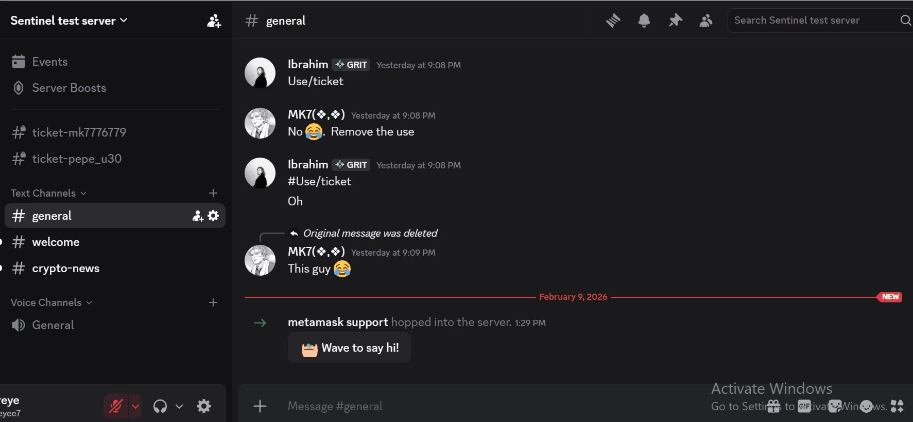
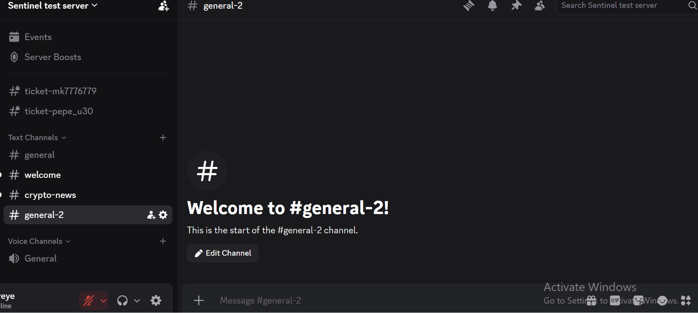
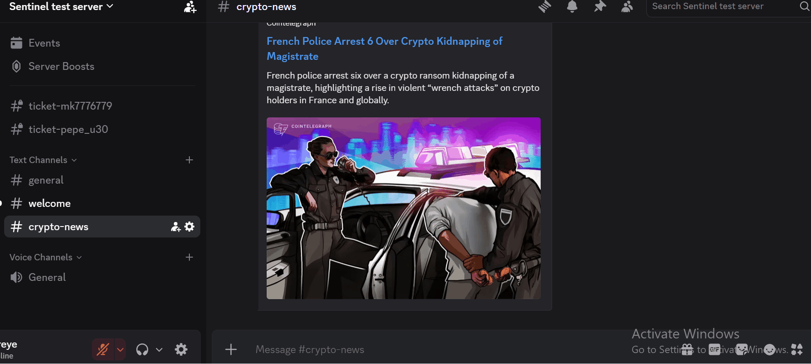

# Sentinel — Discord Community Assistant

> A production Discord community assistant for RAG-backed answers, support tickets, scheduled RSS updates, and configurable scam-pattern moderation.

Sentinel helps Web3 and other online communities answer questions, organize support, share updates, and flag suspicious account patterns. It combines an LLM API integration, web search, and ChromaDB-backed retrieval so community workflows can be handled from Discord.

## What it does

- **Community support:** Uses conversation context and approved knowledge retrieval to help answer member questions.
- **Web research:** Can use search results when a question needs current external context.
- **RSS updates:** Posts updates from configurable feeds on a schedule.
- **Ticket workflow:** Creates private support channels and produces HTML transcripts when tickets close.
- **Scam-pattern moderation:** Scans for configured suspicious patterns, with an on-demand admin scan command.

## Technical stack

- **Runtime:** Python 3.10+ and discord.py
- **AI:** LLM API integration
- **Retrieval:** ChromaDB vector store
- **Integrations:** DuckDuckGo Search, RSS via Feedparser, and image generation with Pillow

## Demo

### Scam-pattern moderation

An example of the moderation workflow and its admin-triggered scan.

### Web research

An example of the research workflow used when current context is needed.

### News updates

An example of the configurable RSS update workflow.

## Quick start

### Public showcase scope

This repository is a project showcase. It includes the demo assets and a dependency snapshot, but it does **not** include the application source code, configuration files, setup script, or deployment instructions. It cannot be run locally from this repository alone.

To see Sentinel in Discord, use the demo server when it is available:

[Join the Sentinel demo server](https://discord.gg/H7Eppfm7)

For source access or deployment details, contact the project owner.

## Status

Sentinel is in production. This public repository is maintained as a focused showcase of its user-facing workflows rather than a full source distribution.
